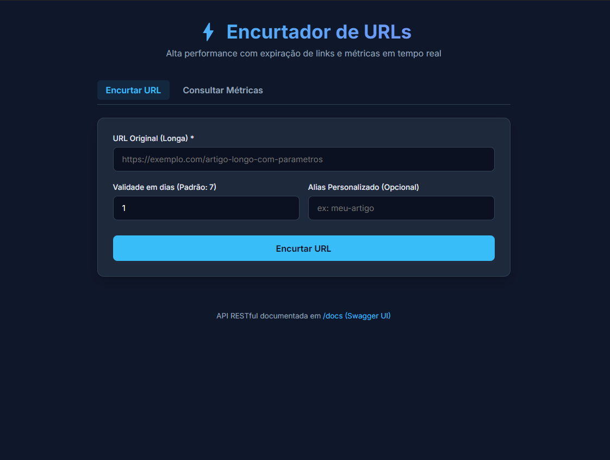
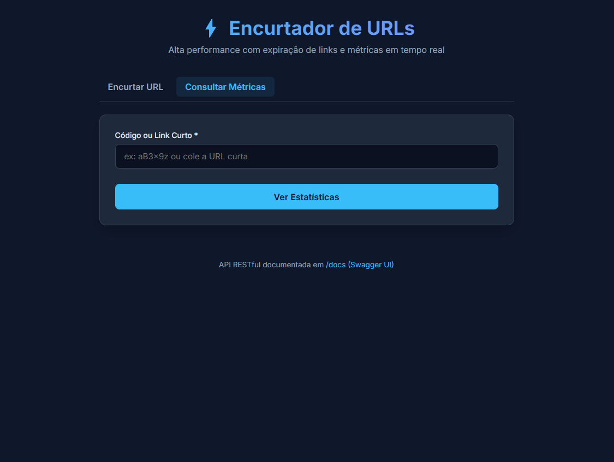
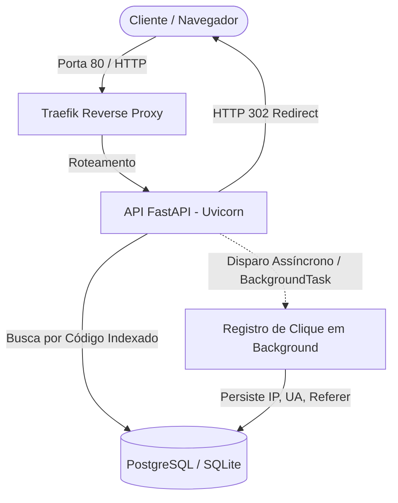

# ⚡ URL Shortener API — Expiration & Click Analytics

> A portfolio-ready REST API built with FastAPI for creating short, expiring URLs and collecting click analytics without delaying redirects.

## About

This project demonstrates practical backend engineering decisions in a compact product: validated URL creation, custom aliases, collision-safe Base62 codes, expiration rules, HTTP 302 redirects, and asynchronous click tracking. It ships with a responsive web interface, OpenAPI documentation, automated tests, and Docker Compose infrastructure using PostgreSQL and Traefik.

**Core stack:** Python · FastAPI · SQLAlchemy · Pydantic · PostgreSQL · Docker · Traefik · Pytest

> **Portfolio note:** this repository contains no production credentials. Before deploying it publicly, supply your own environment variables, restrict CORS, and assess privacy requirements for access metadata such as IP addresses and User-Agent strings.

## Interface preview

The responsive interface keeps the two primary flows simple: creating a short URL and checking its analytics.

| Create a short URL | Check link analytics |
| --- | --- |
|  |  |

---

# Documentação em português

Uma API RESTful moderna, resiliente e de alta performance para encurtamento de URLs, com suporte a expiração programada de links, redirecionamento ultrarrápido (HTTP 302) e rastreamento analítico assíncrono (IP, User-Agent, Referer, dispositivos e navegadores).

Inclui uma **interface web responsiva**, documentação interativa **Swagger/OpenAPI**, suite completa de testes automatizados e orquestração com **Docker Compose** e **Traefik (Reverse Proxy)**.

---

## 🏛️ Arquitetura e Decisões de Engenharia



### Principais Decisões de Design:
1. **Redirecionamento HTTP 302 (Found) em vez de 301 (Moved Permanently):**
   - O código HTTP 301 é cacheado permanentemente pelo navegador do usuário. Se usássemos 301, acessos subsequentes não chegariam ao servidor, impedindo a contagem e auditoria dos cliques. O 302 garante que toda visita seja registrada.
2. **Rastreamento Assíncrono com `BackgroundTasks`:**
   - O redirecionamento é a operação mais sensível a latência. A API retorna o cabeçalho `Location` com status 302 imediatamente e agenda a persistência dos metadados analíticos em segundo plano, evitando overhead no tempo de resposta percebido pelo usuário.
3. **Indexação Estratégica:**
   - Índice único na coluna `codigo` da tabela `links` para garantir consultas em $O(1)$.
   - Índice composto `(link_id, acessado_em)` na tabela `cliques` para agregações analíticas de alta velocidade.
4. **Resolução de Colisão Base62 & Custom Alias:**
   - Geração de códigos curtos aleatórios criptograficamente seguros (6 caracteres do alfabeto Base62) com fallback automático e suporte a alias personalizado (ex: `/meu-link`).

---

## 🚀 Como Executar

### Pré-requisitos
- Python 3.12+ (para execução direta) **ou** Docker e Docker Compose instalados.

---

### Opção 1: Execução Local (Rápida - com SQLite)

1. **Clone o repositório e acesse a pasta:**
   ```bash
   git clone <URL_DO_REPOSITORIO>
   cd Encurtador_URL
   ```

2. **Crie e ative o ambiente virtual:**
   ```bash
   # Windows (PowerShell)
   python -m venv .venv
   .\.venv\Scripts\Activate.ps1

   # Linux / macOS
   python3 -m venv .venv
   source .venv/bin/activate
   ```

3. **Instale as dependências:**
   ```bash
   pip install -r requirements.txt
   ```

4. **Inicie a aplicação:**
   ```bash
   uvicorn app.main:app --reload --port 8000
   ```

5. **Acesse:**
   - 🌐 **Interface Web:** [http://localhost:8000](http://localhost:8000)
   - 📖 **Swagger UI (Documentação Interativa):** [http://localhost:8000/docs](http://localhost:8000/docs)
   - 🩺 **Health Check:** [http://localhost:8000/health](http://localhost:8000/health)

---

### Opção 2: Execução com Docker Compose (Traefik + PostgreSQL)

Para subir todo o ecossistema (Traefik + API FastAPI + PostgreSQL 16) com um único comando:

1. Crie seu arquivo local de configuração a partir do modelo e defina uma senha forte:
   ```bash
   cp .env.example .env
   ```
   No Windows PowerShell: `Copy-Item .env.example .env`

```bash
docker compose up --build -d
```

- 🌐 **Aplicação via Traefik:** [http://localhost](http://localhost)
- 📊 **Dashboard do Traefik:** [http://localhost:8080](http://localhost:8080)

Para parar os containers:
```bash
docker compose down
```

---

## 🧪 Testes Automatizados

A suíte de testes cobre modelos, regras de negócio, colisões, redirecionamento, expiração e rastreamento assíncrono ponta a ponta:

```bash
pytest tests -v
```

Exemplo de saída:
```text
tests/test_database.py::test_create_tables_and_models PASSED             [  6%]
tests/test_e2e.py::test_fluxo_completo_encurtar_redirecionar_e_estatisticas PASSED [ 13%]
tests/test_redirect.py::test_redirecionamento_sucesso PASSED             [ 20%]
tests/test_redirect.py::test_redirecionamento_codigo_inexistente_retorna_404 PASSED [ 26%]
tests/test_redirect.py::test_redirecionamento_link_inativo_retorna_404 PASSED [ 33%]
tests/test_redirect.py::test_redirecionamento_link_expirado_retorna_410 PASSED [ 40%]
tests/test_shortener.py::test_criar_link_sucesso PASSED                  [ 46%]
tests/test_shortener.py::test_validacao_url_invalida PASSED              [ 53%]
tests/test_shortener.py::test_criar_link_com_alias_personalizado PASSED  [ 60%]
tests/test_shortener.py::test_criar_link_alias_duplicado_retorna_409 PASSED [ 66%]
tests/test_shortener.py::test_criar_link_com_dias_validade PASSED        [ 73%]
tests/test_shortener.py::test_criar_link_expiracao_no_passado_retorna_400 PASSED [ 80%]
tests/test_stats.py::test_estatisticas_sem_cliques PASSED                [ 86%]
tests/test_stats.py::test_estatisticas_com_multiplos_cliques PASSED      [ 93%]
tests/test_stats.py::test_estatisticas_link_inexistente_retorna_404 PASSED [100%]

======================== 15 passed in 0.25s ========================
```

---

## 📡 Endpoints da API & Exemplos cURL

### 1. Criar Link Curto
`POST /links`

**Requisição:**
```bash
curl -X POST "http://localhost:8000/links" \
     -H "Content-Type: application/json" \
     -d '{
       "url": "https://github.com/google/gemini",
       "dias_validade": 15,
       "custom_alias": "gemini-repo"
     }'
```

**Resposta (`201 Created`):**
```json
{
  "id": 1,
  "codigo": "gemini-repo",
  "url_original": "https://github.com/google/gemini",
  "url_curta": "http://localhost:8000/gemini-repo",
  "criado_em": "2026-10-30T23:45:00.000000Z",
  "expira_em": "2026-11-14T23:45:00.000000Z",
  "ativo": true
}
```

---

### 2. Acessar / Redirecionar
`GET /{codigo}`

```bash
curl -i "http://localhost:8000/gemini-repo"
```

**Resposta (`302 Found`):**
```http
HTTP/1.1 302 Found
Location: https://github.com/google/gemini
```

*Caso o link tenha expirado:* Retorna `410 Gone`.  
*Caso o código não exista:* Retorna `404 Not Found`.

---

### 3. Estatísticas e Rastreamento
`GET /links/{codigo}/stats`

```bash
curl "http://localhost:8000/links/gemini-repo/stats"
```

**Resposta (`200 OK`):**
```json
{
  "codigo": "gemini-repo",
  "url_original": "https://github.com/google/gemini",
  "url_curta": "http://localhost:8000/gemini-repo",
  "criado_em": "2026-10-30T23:45:00.000000Z",
  "expira_em": "2026-11-14T23:45:00.000000Z",
  "ativo": true,
  "expirado": false,
  "total_cliques": 12,
  "cliques_por_dia": {
    "2026-10-30": 12
  },
  "cliques_por_dispositivo": {
    "Desktop": 8,
    "Mobile": 4
  },
  "cliques_por_navegador": {
    "Chrome": 7,
    "Safari": 4,
    "Firefox": 1
  },
  "ultimos_cliques": [
    {
      "acessado_em": "2026-10-30T23:46:12.000000Z",
      "ip": "203.0.113.195",
      "user_agent": "Mozilla/5.0 (Windows NT 10.0; Win64; x64) AppleWebKit/537.36 Chrome/122.0.0.0",
      "referer": "https://linkedin.com",
      "dispositivo": "Desktop",
      "navegador": "Chrome"
    }
  ]
}
```

---

## 📁 Estrutura do Projeto
```text
Encurtador_URL/
├── app/
│   ├── config.py             # Variáveis de ambiente e constantes
│   ├── database.py           # Conexão SQLAlchemy e SessionLocal
│   ├── models.py             # Entidades Link e Clique
│   ├── schemas.py            # Validação Pydantic (Request/Response)
│   ├── main.py               # App FastAPI, CORS e rotas
│   ├── services/
│   │   ├── shortener.py      # Algoritmo Base62 e códigos únicos
│   │   ├── tracking.py       # Coleta e persistência assíncrona de cliques
│   │   └── stats.py          # Agregação analítica e parsing de User-Agent
│   └── routers/
│       ├── links.py          # POST /links e GET /links/{codigo}/stats
│       └── redirect.py       # GET /{codigo} (HTTP 302 ultrarrápido)
├── static/
│   └── index.html            # Interface Web responsiva integrada
├── tests/
│   ├── conftest.py           # Fixtures compartilhadas e banco em memória
│   ├── test_database.py      # Testes de persistência e relacionamentos
│   ├── test_shortener.py     # Validações de URL, alias e colisões
│   ├── test_redirect.py      # Testes de 302, 404 e 410 (expiração)
│   ├── test_stats.py         # Testes de agregação de métricas
│   └── test_e2e.py           # Teste de integração completo ponta a ponta
├── Dockerfile                # Imagem OCI otimizada (Python 3.12-slim)
├── docker-compose.yml        # Orquestração com Traefik e PostgreSQL 16
├── requirements.txt          # Dependências do projeto
├── pytest.ini               # Configuração do executor de testes
└── README.md                 # Documentação completa
```
